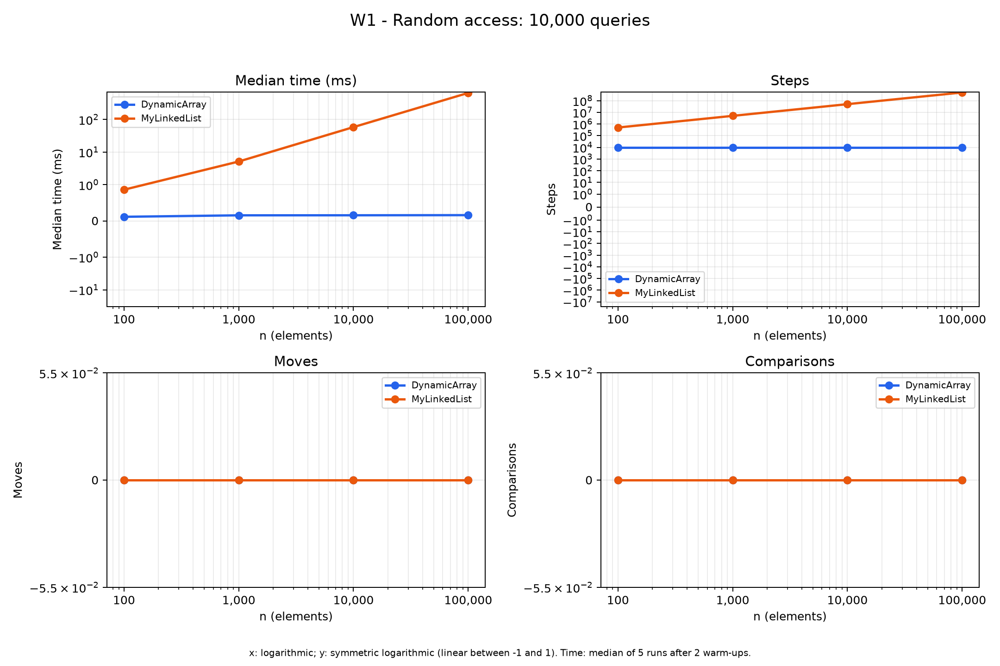
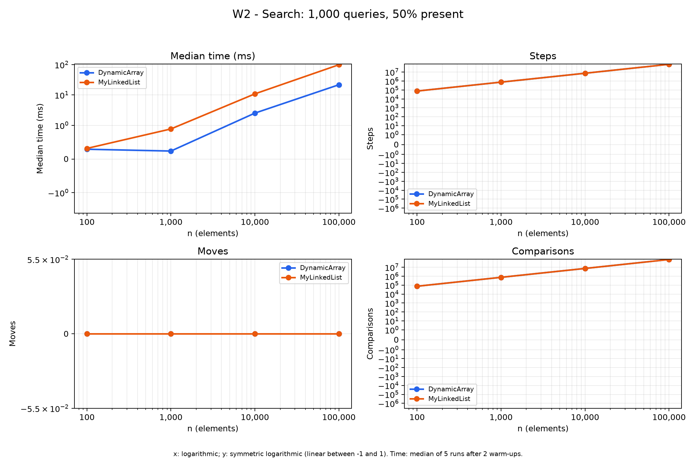
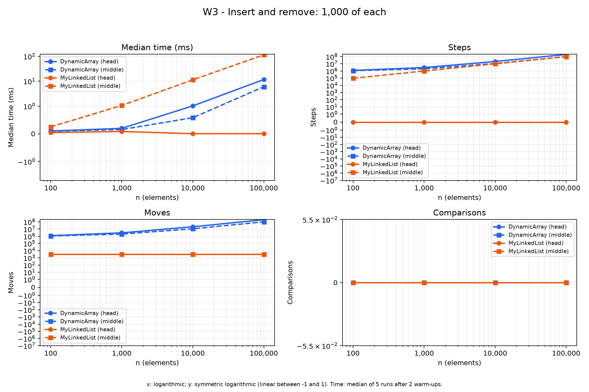
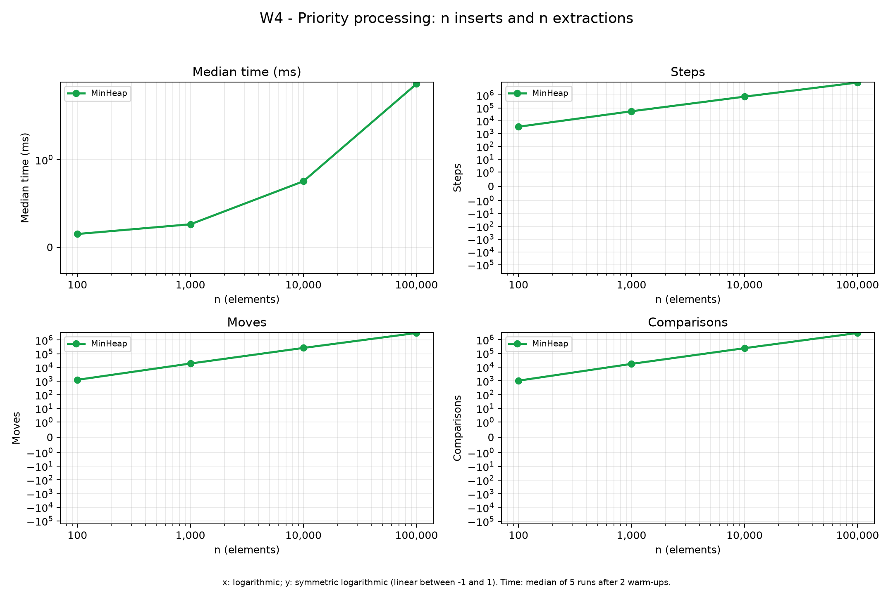

# Assignment 2: Data Structures

**Author:** Assylzhan Amangeldi  
**Group:** SE-2526

## 1. Implementation

DynamicArray stores primitive int values in an array. Its initial
capacity is 8, and its capacity doubles when the array becomes full.
It does not shrink after removal.

MyLinkedList is a singly linked list. Each node stores an int value
and a next reference. Head and tail references allow constant-time
insertion at either end. Removing the last node requires finding
its predecessor.

MinHeap stores primitive int values in an array. Insertion uses
bubble-up, and extraction uses bubble-down. The optional buildHeap
method uses Floyd's bottom-up algorithm and copies the input array.

DynamicArray and MyLinkedList implement the same IntList interface.
Production structures do not use Java collection classes.
Tests use ArrayList and PriorityQueue as reference implementations.

## 2. Complexity analysis

Let n be the number of stored elements before an operation, and i
be a valid index. Bounds describe valid operations for large n.
An invalid index or an empty-heap operation throws in constant time.

Average positional bounds assume uniformly distributed valid indices.
For contains, the average assumes a fixed nonzero proportion of
unsuccessful queries or uniformly distributed successful positions.
Heap averages depend on the input distribution; conservative upper
bounds are shown instead of claiming an unsupported tight average.

Auxiliary space means temporary space used by one operation,
excluding the stored structure.

| Structure | Operation | Best time | Average time | Worst time | Worst auxiliary space | Justification |
|---|---|---|---|---|---|---|
| DynamicArray | add(x) | Theta(1) | Theta(1) amortized | Theta(n) | Theta(n) | Most appends write one cell; a full array copies n values. |
| DynamicArray | add(i,x) | Theta(1) | Theta(n) | Theta(n) | Theta(n) | It shifts n-i values and may allocate a larger array. |
| DynamicArray | remove(i) | Theta(1) | Theta(n) | Theta(n) | Theta(1) | Removing the last value needs no shifts; other positions shift the suffix. |
| DynamicArray | get(i) | Theta(1) | Theta(1) | Theta(1) | Theta(1) | Direct indexing reads one cell. |
| DynamicArray | contains(x) | Theta(1) | Theta(n) | Theta(n) | Theta(1) | A first-position match stops immediately; a miss reads every value. |
| MyLinkedList | add(x) | Theta(1) | Theta(1) | Theta(1) | Theta(1) | The tail reference gives immediate access to the insertion point. |
| MyLinkedList | add(i,x) | Theta(1) | Theta(n) | Theta(n) | Theta(1) | Head and append cases are constant; an interior position requires traversal. |
| MyLinkedList | remove(i) | Theta(1) | Theta(n) | Theta(n) | Theta(1) | Removing the head is constant; other positions require the predecessor. |
| MyLinkedList | get(i) | Theta(1) | Theta(n) | Theta(n) | Theta(1) | It follows exactly i next references from the head. |
| MyLinkedList | contains(x) | Theta(1) | Theta(n) | Theta(n) | Theta(1) | A first-node match is immediate; a miss visits all nodes. |
| MinHeap | insert(x) | Theta(1) | O(log n) amortized | Theta(n) | Theta(n) | Bubble-up takes at most logarithmic time; occasional resizing copies n values. |
| MinHeap | peekMin() | Theta(1) | Theta(1) | Theta(1) | Theta(1) | The minimum is stored at index 0. |
| MinHeap | extractMin() | Theta(1) | O(log n) | Theta(log n) | Theta(1) | Bubble-down may stop immediately or follow the heap height. |
| MinHeap | buildHeap(values) | Theta(n) | Theta(n) | Theta(n) | Theta(n) | Copying costs linear time; the sum of bottom-up sift heights is linear. |

For a fixed index, linked-list get costs Theta(i+1).
Interior linked-list insertion and removal also cost Theta(i+1).
Array removal costs Theta(n-i), and insertion without resizing costs
Theta(n-i+1).

Array append has amortized Theta(1) cost because doubling produces
a geometric sequence of copied capacities: 8 + 16 + 32 + ... .
Across N appends, the total number of copied values is O(N).

Heap insertion without resizing has worst-case Theta(log n).
Including resizing, a single insertion can take Theta(n).
Across a sequence of insertions, resizing contributes amortized O(1)
per operation, so insertion has an amortized O(log n) upper bound.
Its best case gives an Omega(1) lower bound; the average is not
claimed to be Theta(log n) without specifying an input model.

Floyd's algorithm is linear because many nodes are near the leaves.
The number of nodes with height h is O(n / 2^h), so total sift work
is bounded by O(n * sum(h / 2^h)) = O(n).

Total retained storage is Theta(n) for MyLinkedList.
For DynamicArray and MinHeap, it is Theta(capacity): after extensive
removal, unused capacity remains allocated because neither shrinks.

## 3. Measurement method

The benchmark uses n = 100, 1000, 10000 and 100000.
Each case regenerates identical non-negative input using Random(42).
Query generation and initial list filling happen before timing.

W1 performs 10000 random get calls.
W2 performs 1000 contains calls: 500 stored values and 500 guaranteed
absent negative values.
W3 performs 1000 insertions followed by 1000 removals at index 0 or
at the fixed original index n/2.
W4 times n heap insertions and n extractions.

Each case discards two warm-up runs and measures five fresh runs.
The median elapsed time is exported to results/results.csv.
The benchmark also checks that all measured runs have identical
operation counts.

Steps count array-cell reads or traversal to the next node.
Moves count relocation of array elements or structural reference
updates, including head and tail.
Comparisons count comparisons between element values.
Index checks and loop conditions do not count as element comparisons.
A fresh array insertion is not a relocation.
Traversal into a null next reference counts as a traversal step.
Reading a node's value does not count as an array-cell read.

W4 includes writing extracted values into an output array.
Output validation occurs after timing.
W1-W3 validation also occurs after timing and after saving counters.
Instrumentation adds overhead, and two warm-ups cannot guarantee
complete JVM stabilization. These results are classroom measurements
of instrumented implementations.

## 4. Loop invariant proofs

### 4.1 DynamicArray.contains(value)

**Invariant.** Before each iteration with index i, 0 <= i <= size,
and none of the elements at indices 0 through i-1 equals value.
The contents and size of the array remain unchanged.

**Initialization.** Before the first iteration, i = 0.
The inspected prefix is empty, so it contains no matching element.

**Maintenance.** The method compares data[i] with value.
If they are equal, it returns true with a matching element as evidence.
Otherwise data[i] is not a match, so increasing i extends the
non-matching prefix by one element and preserves the invariant.

**Termination.** Each unsuccessful iteration increases i, so
size-i decreases until the loop ends. If i = size, the invariant
covers every stored element, and returning false is correct.
If the method returned earlier, the equality check proves a match exists.

**Conclusion.** The method returns true exactly when a stored
element equals value. The invariant proves the false result,
and the successful equality check proves the true result.

### 4.2 DynamicArray.remove(index)

Let s be the original size, k be the requested valid index, and A
be a mathematical snapshot of the original array.
A is used only in this proof; the implementation does not copy it.

**Invariant.** Before each shift iteration with loop index i:

- k <= i <= s-1.
- For 0 <= j < k, data[j] = A[j].
- For k <= j < i, data[j] = A[j+1].
- For i <= j < s, data[j] = A[j].
- removed = A[k], and size is still s.

**Initialization.** Initially i = k.
The shifted region k <= j < i is empty.
All array elements retain their original values, and removed
has already saved the original value A[k].

**Maintenance.** When i < s-1, the unmodified suffix guarantees
data[i+1] = A[i+1]. Assigning data[i] = data[i+1] therefore puts
the correct successor into position i.
Increasing i extends the shifted region by one element.
The prefix, remaining suffix and saved removed value stay unchanged.

**Termination.** Each iteration increases i; the non-negative
quantity s-1-i decreases. At termination i = s-1, all positions
k through s-2 contain their original successors.
The method decreases size to s-1, excluding the obsolete last cell.

**Conclusion.** The resulting logical sequence is the original
sequence with A[k] removed, and the returned value is exactly A[k].
Removing the last element also satisfies the proof because the
shift loop has zero iterations.

## 5. Benchmark results

Each figure has four panels: median time, steps, moves and comparisons.
Both list implementations appear on the same workload figure.
W3 includes both head and middle variants.
The horizontal axis is logarithmic.
The vertical axis is symmetric logarithmic with a linear region
between -1 and 1, so zero counters remain visible.

### W1: Random access

### W2: Search

### W3: Insert and remove

### W4: Priority processing

### Recorded median times

The following values are copied from the measured CSV, not estimated.

| Workload | Variant | Structure | n | Median time (ms) |
|---|---|---|---|---|
| W1 | - | DynamicArray | 100 | 0.115300 |
| W2 | - | DynamicArray | 100 | 0.289500 |
| W3 | head | DynamicArray | 100 | 0.103200 |
| W3 | middle | DynamicArray | 100 | 0.097600 |
| W1 | - | MyLinkedList | 100 | 0.862900 |
| W2 | - | MyLinkedList | 100 | 0.314000 |
| W3 | head | MyLinkedList | 100 | 0.046200 |
| W3 | middle | MyLinkedList | 100 | 0.252500 |
| W4 | - | MinHeap | 100 | 0.151700 |
| W1 | - | DynamicArray | 1000 | 0.155900 |
| W2 | - | DynamicArray | 1000 | 0.235900 |
| W3 | head | DynamicArray | 1000 | 0.198400 |
| W3 | middle | DynamicArray | 1000 | 0.156800 |
| W1 | - | MyLinkedList | 1000 | 5.151200 |
| W2 | - | MyLinkedList | 1000 | 0.891900 |
| W3 | head | MyLinkedList | 1000 | 0.086300 |
| W3 | middle | MyLinkedList | 1000 | 1.067300 |
| W4 | - | MinHeap | 1000 | 0.262700 |
| W1 | - | DynamicArray | 10000 | 0.157100 |
| W2 | - | DynamicArray | 10000 | 2.524500 |
| W3 | head | DynamicArray | 10000 | 1.023200 |
| W3 | middle | DynamicArray | 10000 | 0.582100 |
| W1 | - | MyLinkedList | 10000 | 58.472200 |
| W2 | - | MyLinkedList | 10000 | 10.880900 |
| W3 | head | MyLinkedList | 10000 | 0.005800 |
| W3 | middle | MyLinkedList | 10000 | 11.368500 |
| W4 | - | MinHeap | 10000 | 0.754000 |
| W1 | - | DynamicArray | 100000 | 0.160900 |
| W2 | - | DynamicArray | 100000 | 21.718100 |
| W3 | head | DynamicArray | 100000 | 11.681500 |
| W3 | middle | DynamicArray | 100000 | 5.998800 |
| W1 | - | MyLinkedList | 100000 | 653.750800 |
| W2 | - | MyLinkedList | 100000 | 99.186900 |
| W3 | head | MyLinkedList | 100000 | 0.005200 |
| W3 | middle | MyLinkedList | 100000 | 114.262700 |
| W4 | - | MinHeap | 100000 | 9.145100 |

## 6. Discussion

1. DynamicArray get reads one array cell, while MyLinkedList get follows i next references.
2. With uniformly selected indices, the list therefore performs approximately (n-1)/2 traversal steps per get.
3. Consecutive int values in an array provide spatial locality because nearby values can share CPU cache lines.
4. Sequential array access can also benefit from hardware prefetching.
5. Linked nodes are separate objects and are not guaranteed to occupy consecutive memory locations.
6. Pointer chasing creates dependent loads because the next address becomes known only after reading the current node.
7. Consequently, equal asymptotic complexity or similar counted work does not guarantee equal elapsed time.
8. Node object headers, references and alignment add storage overhead beyond the primitive int value.
9. Allocating many nodes can also increase garbage-collection work, although this benchmark does not measure that effect separately.
10. W2 has linear average search work in both implementations, while physical layout can produce different running times.
11. For W3 head operations, the list updates a fixed number of references, whereas the array shifts a large suffix.
12. For W3 middle operations, the singly linked list must traverse to the predecessor, so indexed insertion is not constant-time.
13. MyLinkedList is a better candidate for frequent head insertion and removal or operations where a predecessor node is already available.
14. MinHeap is a better choice for repeatedly selecting the smallest pending job, and Floyd buildHeap is useful when all initial jobs are available together.
15. Actual timings must be interpreted alongside operation counts because instrumentation, JVM compilation and background activity influence the measurements.

## 7. Testing and limitations

JUnit tests cover empty structures, one element, duplicates, negative
values, first and last indices, invalid indices and reuse after clearing.
Random list operations are compared with ArrayList.
Random heap operations are compared with PriorityQueue.
The heap property is checked after each tested insertion and extraction.
Sorted extraction is checked against Arrays.sort.
Additional tests check selected exact counter values.

The four required workloads generate 36 CSV rows.
The benchmark validates random-access checksums, search hit counts,
restoration after indexed insertions and removals, and sorted heap output.

Floyd buildHeap is implemented and tested, but a separate comparison
against repeated insertions is not included in the required-workload CSV.
Therefore the complete buildHeap bonus experiment is not claimed.
JOL memory-footprint measurements are also not included.
